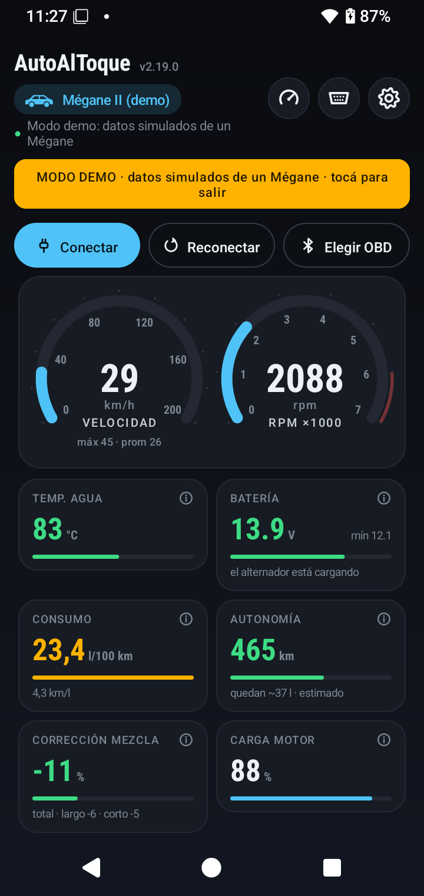
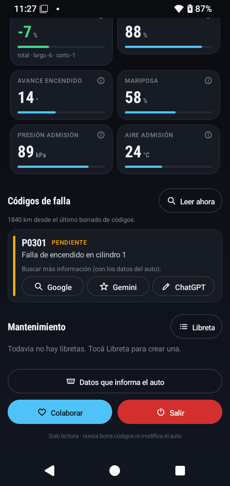
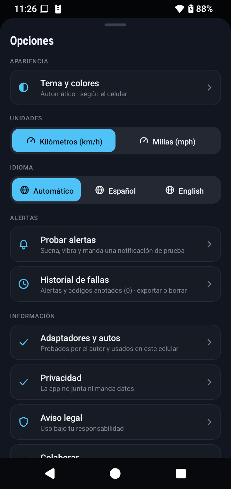

<h1 align="center">AutoAlToque</h1>

<h2 align="center"><a href="https://github.com/matcarfer/AutoAlToque/releases/download/v2.19.0/AutoAlToque-2.19.0.apk">⬇ Download APK</a></h2>

  <a href="README.md">Español</a> · <b>English</b>  
See live how your car's engine is doing: data, alerts, fault codes and logbook. 
Read-only: it never clears codes or changes anything in the car. 
<b>Compatible with Android 7 to 16.</b>

  
  
  

**What you need:** a **Bluetooth OBD2 ELM327** adapter and a car with an OBD2 port. You can try it without a car in demo mode.

  <a href="https://cafecito.app/matcarfer">☕ Cafecito</a> · <a href="https://ko-fi.com/matcarfer">☕ Ko-fi</a> · <a href="https://www.patreon.com/matcarfer">❤ Patreon</a> 
  <a href="https://github.com/matcarfer/biblioteca/blob/main/README.en.md">📚 Software library</a>

---

Free, closed source. Do not redistribute: share this link. No warranty. <a href="LICENSE.en">License</a> · <a href="PRIVACY.md">Privacy</a> · <a href="https://www.virustotal.com/gui/file/4aa9bb100a593b3816b241b31ffb7061e229e31932a9af1f9270a10c440dab0f">VirusTotal</a>
