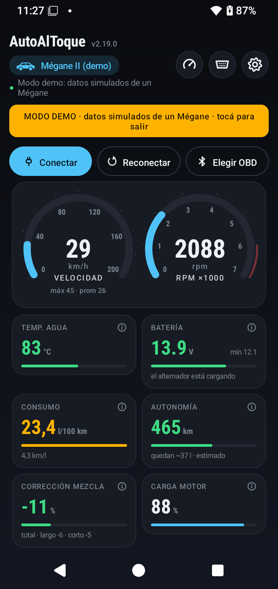
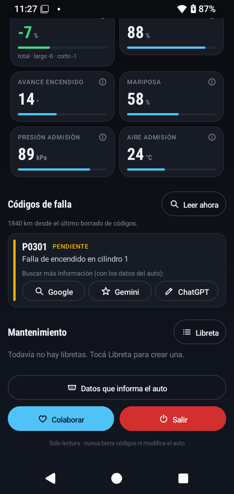
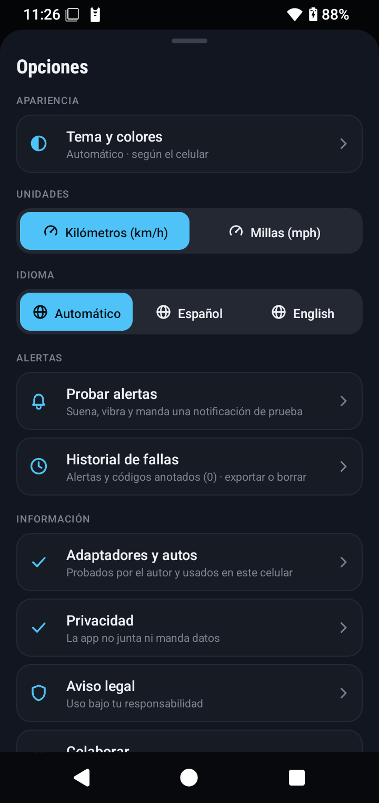

<h1 align="center">AutoAlToque</h1>

<h2 align="center"><a href="https://github.com/matcarfer/AutoAlToque/releases/download/v2.19.0/AutoAlToque-2.19.0.apk">⬇ Descargar APK</a></h2>

  <b>Español</b> · <a href="README.en.md">English</a>  
Mirá en vivo cómo anda el motor de tu auto: datos, alertas, códigos de falla y libreta. 
Solo lee: nunca borra códigos ni cambia nada en el auto. 
<b>Compatible con Android 7 a 16.</b>

  
  
  

**Qué necesitás:** un adaptador **OBD2 ELM327 Bluetooth** y un auto con puerto OBD2. Podés probarla sin auto con el modo demo.

  <a href="https://cafecito.app/matcarfer">☕ Cafecito</a> · <a href="https://ko-fi.com/matcarfer">☕ Ko-fi</a> · <a href="https://www.patreon.com/matcarfer">❤ Patreon</a> 
  <a href="https://github.com/matcarfer/library">📚 Biblioteca de software</a>

---

Gratis, de código cerrado. No redistribuir: compartí este link. Sin garantía. <a href="LICENSE">Licencia</a> · <a href="PRIVACY.es.md">Privacidad</a> · <a href="https://www.virustotal.com/gui/file/4aa9bb100a593b3816b241b31ffb7061e229e31932a9af1f9270a10c440dab0f">VirusTotal</a>
